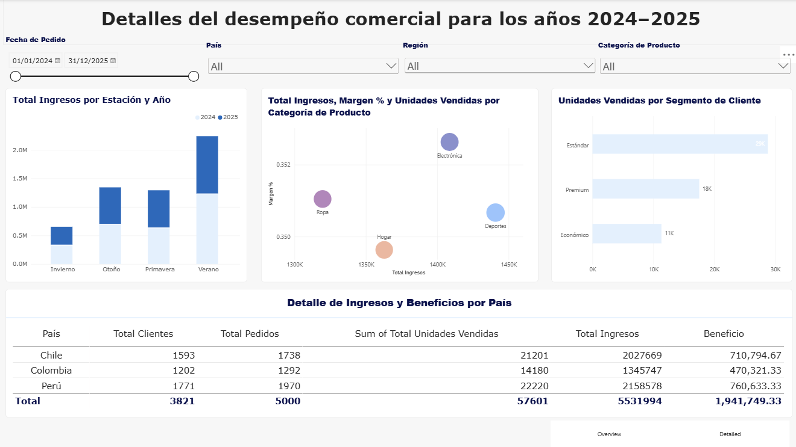
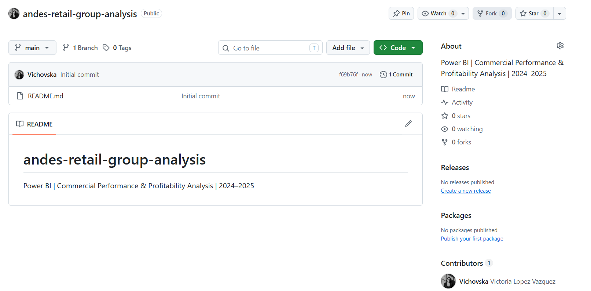

# Andes Retail Group
## Commercial Performance & Profitability Analysis | 2024–2025

**Tools:** Power BI | Business Intelligence | Data Visualisation

**Markets:** Chile, Colombia & Peru

**Project type:** Retail analytics case study

---

## 01. Project Overview

This project explores the commercial performance of Andes Retail Group across three Latin American markets during 2024–2025.

Using Power BI, I developed two complementary dashboards to examine revenue, profitability, sales trends, product categories, customer segments, and geographical performance.

The objective was to transform transactional retail data into accessible business intelligence that supports commercial decision-making.

## 02. Business Objectives

The analysis addresses five key questions:

1. How does revenue performance evolve over time?
2. Which product categories contribute most to sales and profitability?
3. How does commercial performance vary across Chile, Colombia, and Peru?
4. What seasonal patterns emerge in sales activity?
5. How do customer segments contribute to total units sold?

## 03. Dashboard 1 — Commercial Performance Overview

The executive dashboard provides an overview of commercial performance, including:

- Total revenue
- Total profit
- Profit margin
- Total orders
- Monthly revenue trends
- Revenue by product category
- Country-level revenue and profit analysis

Interactive filters allow users to explore performance by date, country, region, and product category.

## 04. Dashboard 2 — Detailed Commercial Analysis

The detailed dashboard expands the analysis through:

- Seasonal revenue comparisons
- Revenue, margin, and units sold by product category
- Customer segmentation by units sold
- Country-level performance tables
- Revenue and profitability comparisons

Together, both dashboards provide an executive overview and a more granular perspective on commercial performance.

## 05. Key Performance Indicators

The report tracks:

| KPI | Description |
|---|---|
| Total Revenue | Revenue generated from retail sales |
| Total Profit | Profit generated from sales activity |
| Profit Margin | Profit relative to revenue |
| Total Orders | Number of customer orders |
| Units Sold | Total product units sold |
| Category Revenue | Revenue contribution by product category |

## 06. Analytical Approach

The project uses Power BI to organise and visualise retail performance data.

The analytical workflow focuses on:

1. Identifying commercially relevant KPIs.
2. Comparing performance across markets and categories.
3. Analysing monthly and seasonal sales trends.
4. Exploring customer segments and sales volumes.
5. Developing interactive dashboards to support business interpretation.

## 07. Business Applications

The dashboards can support commercial teams in:

- Monitoring revenue and profitability.
- Identifying category performance differences.
- Evaluating geographical sales contributions.
- Understanding seasonal demand patterns.
- Supporting assortment and commercial planning discussions.

These are potential applications of the analysis, rather than measured business outcomes.

## 08. Project Files

- `andes_overview.png` — Executive dashboard screenshot.
- `andes_detailed.png` — Detailed dashboard screenshot.

## 09. About the Analyst

**Victoria López Vázquez**

Data Analytics | Business Intelligence | Commercial Strategy

Combining experience in international retail merchandising and commercial performance management with analytical skills in Power BI, Excel, SQL, and Python.

[View my Data Analytics Portfolio](https://vichovska.github.io/)

---

*Portfolio project developed as part of my data analytics training.*
